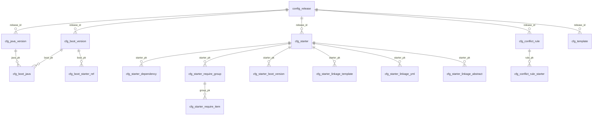

# 配置结构化入库与表单化维护（规划稿）

> 状态：**T1（db-schema）、T2（snapshot-assembler）、T3（admin-structured-api）、
> T4（yaml-import-export）、T5（template-db-source）、T6（web-forms）已实施**；T7 起待开发
> T1 交付：`initializer-app/src/main/resources/db/{schema,data}.sql` + 16 个实体/Mapper +
> `ConfigRepository` 结构化读写 + `StructuredSnapshot`/`StructuredYamlCodec`/`StructuredDraftWriter`/
> `LegacyYamlMigration`（T1→T2 过渡桥）+ 升级文档（`docs/guide/configuration.md` §6）
> T2 交付：`initializer-core` 的 `MetadataCatalog.of(...)` 公共工厂 +
> `StructuredCatalogAssembler`（表行直装快照）+ `ConfigService` 发布/回滚改结构化装配 +
> `CatalogSnapshotBootstrap` 启动直装 + `CatalogSnapshot` 模板语义改「DB 全量模板集」
> + 装配文档（`docs/guide/configuration.md` §7）
> T3 交付：管理端分模块结构化 API（`CatalogDtos` + `StructuredDraftService` +
> `AdminApiController` 结构化端点）+ `CatalogSyncService` 直写结构化 starter 行
> + `ConfigRepository` 按 kind 替换与模板轻量查询
> + 结构化 API 文档（`docs/guide/configuration.md` §8）
> T4 交付：ZIP 导入导出（`ConfigArchiveCodec` + `StructuredSnapshotCodec` +
> `ConfigImportExportService` + `AdminApiController` 的 `/config/export`、`/config/import`）
> + 导入侧安全加固（路径穿越 / 条目数 / 单文件与总量 / 严格 UTF-8）
> + `ErrorCode` 40xx 导入导出错误码 + `cfg_starter` 唯一约束补 `source` 通道维度
> + 文档（`docs/guide/configuration.md` §9）
> T5 交付：模板改为 DB 唯一数据源（`TemplateRenderer` 摘除 `ClassTemplateLoader` 兜底、
> `LinkageRenderer` 摘除 yml 片段 classpath 兜底并暴露 `validateRequirements` 模板可达性校验、
> `ProjectGenerator.validate(...)` 前置校验、`GeneratorService`/`GeneratorConfig` 适配「DB 全量模板集」、
> `DemoCatalogSeeder` + `DemoCatalogWriter` 实现「内置清单与模板入库 → 自动发布一版」、
> `CatalogSnapshotBootstrap` demo 分支改走 DB 发布装表
> + 文档（`docs/guide/configuration.md` §10）
> T6 交付：前端表单化工作台（`AdminPanel.vue` 改左导航 + 卡片表单外壳；
> 新增 `components/admin/{MetadataForm,StarterForm,ConflictRuleForm,TemplateForm,PublishConsole,ImportExportPanel}.vue`；
> `api/client.ts` 补 `adminStructuredApi` / `adminArchiveApi` / `adminApi.sync`；
> `types/admin.ts` 对齐 `CatalogDtos` + `ConfigArchiveDtos`；`stores/starterConfigWizard.ts` 改结构化提交；
> 删除 `starter-yaml-builder.ts`，`config/admin-config-templates.ts` 退化为字段释义与占位示例）
> + 文档（`docs/guide/configuration.md` §11，验证清单顺延 §12 并加 T6 冒烟 3 条）
> 勘误：§12 的 ER 图实为 **15 张 `cfg_*` 表**（非 17）；实体为 15 张 + `ConfigDraftMetaEntity` = 16
> 来源：需求「元数据/starter清单/冲突规则/模板 改为表单维护 + 关系表存储 + YAML 导入导出」
> 关联：M3 里程碑（`docs/design/m3-overview.md`、`docs/design/m3-detail.md`）
> 归档日期：2026-09-11

## 1. 需求原文

> 优化一下 元数据/starter清单/冲突规则/模板，改成表单形式维护，并建立对应数据库表及关系，页面维护后，存入数据库表，包括模板的内容都放在表里，之后使用的时候都读表，不要用 yml 了。新增功能：可以将数据库转换为 yml 文件下载即可，也可以通过导入 yml 解析进入数据库。

### 1.1 澄清确认

| # | 决策点 | 结论 |
|---|---|---|
| 1 | 发布机制 | **保留**「草稿 → 发布 → 历史版本 → 回滚」。表单写入结构化草稿表，发布后生成**关系表版本快照**并热生效，保留审计与回滚。 |
| 2 | 运行时读取 | **保留内存快照**：启动时/每次变更后由关系表构建 `CatalogSnapshot` 原子热切换，运行时请求读内存快照。 |
| 3 | 模板范围 | 内置模板**全量入库**；生产模式不再有 classpath 模板兜底；仅 `--demo` 演示模式以 classpath 内置清单与模板作初始种子。 |
| 4 | 导入导出格式 | **ZIP**，目录结构与原 catalog 布局一致（`metadata.yml` + `starters/*.yml` + `conflict-rules.yml` + `templates/**/*.ftl`）。 |

## 2. 产品概述

将脚手架生成平台的四类配置（元数据、starter 清单、冲突规则、生成模板）从「YAML 文本手工维护」升级为「表单结构化维护 + 关系数据库存储」，运行时不再读取 YAML 文件，全部以数据库为唯一数据源；同时新增数据库与 YAML 之间的导入导出能力（导出 ZIP 下载、导入 ZIP 解析入库）。保留现有「草稿 → 发布 → 历史版本 → 回滚」版本化机制与审计能力。

## 3. 核心功能

- **元数据表单维护**：Java 版本清单、Spring Boot 版本清单、两者兼容矩阵、每个 Boot 版本可选的 starter 白名单、框架父 POM（groupId/artifactId/version）均以表单增删改，存关系表。
- **starter 清单表单维护**：starter 基本信息（id/分类/维护方/描述/是否必选）、依赖坐标、依赖联动分组（AND-of-OR）、Boot 版本关联、联动规则（配置包名、模板联动、application.yml 片段、抽象类）以表单维护，存关系表。
- **冲突规则表单维护**：规则（pair/group）、涉及 starter 多选、提示文案以表单维护，存关系表。
- **模板表单维护**：模板名 + 模板内容（FreeMarker 全文）入库，支持列表浏览与在线编辑预览；生产模式运行时模板只来自数据库。
- **草稿与发布**：表单编辑写入草稿区，点「发布」整体校验后生成版本化关系快照并热生效；支持发布历史查看、回滚到任意历史版本；操作留审计日志。
- **数据库 ↔ YAML 导入导出**：一键把当前配置导出为目录结构一致的 ZIP 下载；上传 ZIP 后解析校验并回填数据库草稿，校验失败整体拒绝并给出明细。
- **演示模式**：仅 `--demo` 演示启动时，用内置清单与内置模板作为初始种子灌入数据库，之后同样统一读表。

## 4. 视觉与交互

管理后台由「YAML 文本框」改为模块化表单工作台：左侧分区导航（发布台 / 元数据 / starter 清单 / 冲突规则 / 模板 / 导入导出），右侧为卡片式表单与可编辑表格；版本下拉、starter 多选、模板内容编辑区、导入导出按钮等交互清晰，发布与回滚结果、校验错误明细以提示条呈现。整体沿用现有深色顶栏与 Spring 绿品牌色（`#6DB33F`），风格统一、专业。

## 5. 技术栈

- **后端（沿用现有）**：Java 17 + Spring Boot、MyBatis-Plus、H2（可替换任意 JDBC 数据源）、SnakeYAML SafeConstructor、FreeMarker。
- **前端（沿用现有）**：Vue 3 + TypeScript + Pinia + Vite；新增 TDesign Vue Next 作为企业级表单/表格组件库。
- **构建**：Maven 多模块（initializer-api / initializer-core / initializer-app / initializer-web）。

## 6. 实现思路

核心策略：**用一套带版本作用域的关系表替换「YAML 文本 CLOB」，并复用既有核心校验与内存快照机制。**

1. **关系表 + `release_id` 作用域**：所有配置业务表带 `release_id BIGINT NOT NULL`，`0` 表示当前草稿工作区，`>0` 表示某次发布快照（等于 `config_release.id`）。草稿编辑只改 `release_id=0` 的行；发布时在同一事务内把草稿行复制成带新 `release_id` 的不可变快照行；回滚读取目标 release 的行重新校验后生成新 release。既满足「关系表版本化」，又保留草稿/发布/回滚/审计语义。
2. **表行 → 核心模型 → 快照装配**：新增 `StructuredCatalogAssembler`，按 `release_id` 批量查询各子表，内存分组装配为 `MetadataCatalog`、`StarterCatalog`、`ConflictCatalog` 与「模板名 → 模板全文」映射，复用 core 既有装载期校验（`StarterCatalog.of`、`ConflictCatalog` 构造、requires/占位符/悬空引用校验），再 `metadata.merge(starterCatalog)` 得到快照。装配失败即发布校验失败（4002）。
3. **运行时仍读内存快照**：`CatalogSnapshotHolder` 原子切换保持不变；`MetadataService` / `GeneratorService` 读路径零感知。启动播种改为「从最新 release 的结构化表装配」，非 demo 且表为空则空快照。
4. **模板去 classpath 兜底**：`CatalogSnapshot` 的 `templateOverrides` 语义从「覆盖 + 内置兜底」改为「数据库全量模板集」；`TemplateRenderer` 仅用 `StringTemplateLoader`（不再挂 `ClassTemplateLoader`）。仅 `--demo` 启动时把 classpath 内置清单与模板作为种子写入数据库后自动发布一版，运行时统一读表。
5. **导入导出复用既有解析器**：导出用 SnakeYAML `Yaml.dump`（块风格）把表行渲染为 `metadata.yml` / `starters/*.yml` / `conflict-rules.yml` / `templates/**`，打包 ZIP 流式下载；导入用 multipart 接收 ZIP，解包后复用 `MetadataCatalog.load`、`YamlStarterParser`、`ConflictRuleParser`、模板语法校验解析校验，全部通过后事务内写草稿表（`release_id=0`），失败整体回滚。
6. **同步通道结构化**：制品库同步（STARTER_SYNC）不再写 YAML 草稿，改为写结构化 starter 草稿行并带 `source` 标记（MANUAL/SYNC），同名手工优先语义保持。

### 6.1 关键取舍

- 未采用「草稿表 + 发布镜像表」双套表，而用单套表 + `release_id` 作用域，表数量与复制逻辑减半；代价是唯一约束与查询均需带 `release_id`（已在设计上统一收口到 Repository 层）。
- 未采用「每次请求实时查库」，保留快照以维持生成/元数据读路径的无锁低延迟；表查询只发生在启动、发布、回滚、导入导出等低频路径。
- `validation.yml`（Group/Artifact/Package 命名规则）不在本次四项范围内，保持 classpath 现状。

## 7. 数据模型（关系与约束）

- **元数据**：`cfg_java_version(release_id, version_id, label, deprecated, recommended_boot_version, sort)`；`cfg_boot_version(release_id, version_id, label, official, fp_group, fp_artifact, fp_version, sort)`；`cfg_boot_java(release_id, boot_pk, java_pk)` 兼容矩阵多对多；`cfg_boot_starter_ref(release_id, boot_pk, starter_id, sort)` 可选 starter 白名单。
- **starter**：`cfg_starter(release_id, starter_id, category, maintainer, description, required, hidden, config_package, source, sort)`；`cfg_starter_dependency(release_id, starter_pk, group_id, artifact_id, version, sort)`；`cfg_starter_require_group(release_id, starter_pk, group_index)` + `cfg_starter_require_item(release_id, group_pk, required_starter_id, sort)` 表达 AND-of-OR；`cfg_starter_boot_version(release_id, starter_pk, boot_version_id)`；`cfg_starter_linkage_template / _yml / _abstract` 分别存三类联动。
- **冲突规则**：`cfg_conflict_rule(release_id, rule_id, type, message, sort)` + `cfg_conflict_rule_starter(release_id, rule_pk, starter_id, sort)`。
- **模板**：`cfg_template(release_id, name, content CLOB, sort, updated_at)`。
- **版本与元信息**：保留 `config_release(id, released_by, released_at, remark, source)` 头表与 `config_audit`；新增 `config_draft_meta(kind, version, updated_by, updated_at)` 承载 kind 级乐观锁（替代原 `config_draft.content_yaml`）。
- **唯一性**：父表 `UNIQUE(release_id, version_id/starter_id/rule_id/name)`；子表 `UNIQUE(release_id, 父键, 维度键)`；全部外键在 `release_id` 作用域内解析，跨作用域不引用。



## 8. 关键代码结构

为支持「表行直接装配」，需给 core 的不可变目录类补公共工厂入口（现 `MetadataCatalog` 构造私有、仅能从 YAML 装载）：

```java
// initializer-core: MetadataCatalog 新增公共工厂（复用私有构造的图校验）
public static MetadataCatalog of(List<JavaVersion> javaVersions,
                                 List<BootVersion> bootVersions);
// StarterCatalog.of(List<StarterCatalogEntry>) 与 ConflictCatalog(List<ConflictRule>) 已公开，直接复用

// initializer-app: 新增装配器（按 release_id 作用域装表，输出绑定 release 的快照）
CatalogSnapshot assemble(long releaseId);   // 批量查子表 -> 分组 -> 装配 -> merge -> 快照
```

## 9. 目录结构（改动清单）

本方案在现有四模块工程上改造，替换 YAML 持久化为结构化表并新增导入导出。

```
initializer-app/
├── src/main/resources/db/
│   ├── schema.sql                    # [MODIFY] 新建 cfg_* 关系表 + config_draft_meta；config_release 收敛为头表；保留 config_audit
│   └── data.sql                      # [MODIFY] 预置 config_draft_meta 的 metadata/starter/conflict-rule/template 四行（version=0）
├── src/main/java/com/wymix/initializer/app/admin/
│   ├── entity/                       # [NEW] 结构化实体：CfgJavaVersionEntity/CfgBootVersionEntity/CfgBootJavaEntity/CfgBootStarterRefEntity/
│   │                                 #       CfgStarterEntity/CfgStarterDependencyEntity/CfgStarterRequireGroupEntity/CfgStarterRequireItemEntity/
│   │                                 #       CfgStarterBootVersionEntity/CfgStarterLinkageTemplateEntity/CfgStarterLinkageYmlEntity/
│   │                                 #       CfgStarterLinkageAbstractEntity/CfgConflictRuleEntity/CfgConflictRuleStarterEntity/
│   │                                 #       CfgTemplateEntity/ConfigDraftMetaEntity
│   ├── mapper/                       # [NEW] 上列实体对应 MyBatis-Plus Mapper（批量插入/按 release_id 分组查询）
│   ├── repository/ConfigRepository.java  # [MODIFY] 收口结构化表的按 release_id 读写、草稿复制为发布、发布行读取、草稿乐观锁
│   ├── repository/ConfigArchiveCodec.java        # [DONE-T4] ZIP 打包/解包 + 路径穿越/上限/UTF-8 安全加固
│   ├── repository/StructuredSnapshotCodec.java   # [DONE-T4] 归档 YAML 文档 → 结构行（复用 core 解析器）
│   ├── dto/ConfigArchiveDtos.java                # [DONE-T4] 导入/导出响应 DTO
│   ├── refresh/
│   │   ├── StructuredCatalogAssembler.java  # [NEW] 表行 -> 核心模型 -> CatalogSnapshot，复用 core 校验
│   │   ├── CatalogRefresher.java            # [MODIFY] 保留 YAML 解析供导入导出；新增结构化装配委托
│   │   ├── CatalogSnapshot.java             # [MODIFY] template 语义改为 DB 全量模板集
│   │   └── CatalogSnapshotBootstrap.java    # [MODIFY] 启动从最新 release 装表；demo 模式播种入库后统一走表
│   ├── service/
│   │   ├── ConfigService.java               # [MODIFY] 草稿/发布/回滚改为结构化读写；发布=复制行为新 release_id
│   │   └── ConfigImportExportService.java   # [DONE-T4] ZIP 导入解析入库 / 导出 DB 为 ZIP
│   ├── controller/AdminApiController.java   # [MODIFY] 分模块结构化 CRUD + 导入导出端点（multipart/下载）
│   └── sync/                                # [MODIFY] 同步结果改写结构化 starter 草稿（source=SYNC）
├── src/main/java/com/wymix/initializer/app/generator/GeneratorService.java  # [MODIFY] 适配全量模板集渲染
initializer-core/
├── src/main/java/com/wymix/initializer/core/metadata/MetadataCatalog.java   # [MODIFY] 新增公共工厂 of(...)
└── src/main/java/com/wymix/initializer/core/generator/TemplateRenderer.java # [MODIFY] 仅 StringTemplateLoader（无 classpath 兜底）
initializer-api/
└── src/main/java/com/wymix/initializer/api/error/ErrorCode.java  # [DONE-T4] 40xx 段补 4008/4009/4010
initializer-web/
├── src/api/client.ts                  # [MODIFY] 结构化 CRUD、导入导出、发布/回滚/审计接口
├── src/types/api.ts                   # [MODIFY] 结构化 DTO 与导入导出响应类型
├── src/components/AdminPanel.vue      # [MODIFY] 改为左侧分区导航 + 表单工作台外壳
├── src/components/admin/              # [NEW] MetadataForm.vue / StarterForm.vue（复用向导分步）/ ConflictRuleForm.vue /
│                                      #       TemplateForm.vue / PublishConsole.vue / ImportExportPanel.vue
├── src/stores/starterConfigWizard.ts  # [MODIFY] 改为结构化提交（不再拼 YAML）
└── src/config/admin-config-templates.ts  # [MODIFY] 示例 YAML 改为字段说明/占位数据
docs/
├── guide/configuration.md            # [MODIFY] 配置改为表单+关系表+导入导出说明
└── design/m3-*.md                    # [MODIFY] 补充关系表与版本快照设计
```

## 10. 实现要点（防回归）

- **性能**：装配为 O(表行数) 一次性内存操作，子表按 `release_id` 批量查询后在内存按父键分组，严禁逐行查库（避免 N+1）；`cfg_template.content` 为大文本 CLOB，列表页仅查 name/更新时间，编辑与生成时按需取 content。
- **事务与原子性**：发布 = 写 release 头 + 复制行为新 `release_id` + 快照切换，全部在同一事务内，快照切换置于事务末尾；沿用现有 `publishLock` 互斥与 `noRollbackFor=BusinessException` 失败审计留痕。
- **输入校验与安全**：导入 ZIP 需限制条目数量/单文件大小/路径穿越（拒绝 `..` 与绝对路径）；所有配置文本按 UTF-8 读取；SnakeYAML 继续使用 SafeConstructor。
- **日志**：沿用 SLF4J；导入导出、发布、回滚记录规模（行数/模板数/规则数）与结果，不打印模板全文与 token。
- **回归控制**：导入失败整体回滚不污染草稿；发布失败旧快照继续服务；`config_release` 旧 `*_yaml` 列废弃后，历史 YAML 数据通过「旧版本导出 → 新版本导入」迁移，并在文档中说明。

## 11. 兼容边界

- `validation.yml` 不在本次范围，保持 classpath 现状。
- 外部目录 `initializer.catalog.dir` 的 jar 外 YAML 加载能力由「ZIP 导入」替代（不再运行时读取）。
- `STARTER_SYNC` 通道改为写入结构化 starter 草稿表（含 `source` 标记），同名手工优先语义保持。
- 需评估既有测试（`initializer-app/src/test/resources/catalog/**`、`initializer-core/src/test/resources/**`、各 `*Test`）受影响范围并同步调整。

## 12. 实施步骤（Todo）

| # | id | 任务 | 依赖 |
|---|---|---|---|
| 1 | `db-schema` | ✅ 建元数据/starter/冲突规则/模板关系表 DDL（15 张）及实体、Mapper、按 `release_id` 作用域的 Repository | — |
| 2 | `snapshot-assembler` | ✅ 新增 `StructuredCatalogAssembler`（表行直装），发布/回滚/启动三条链路改结构化装配，`MetadataCatalog.of` 公共工厂 | 1 |
| 3 | `admin-structured-api` | ✅ 改造管理端为分模块结构化读写 API，制品库同步改写结构化 starter 草稿（source 标记） | 2 |
| 4 | `yaml-import-export` | ✅ 实现 ZIP 导入解析入库与导出下载，复用 core 解析器并补充导入导出错误码 | 2 |
| 5 | `template-db-source` | ✅ 模板渲染改为只读数据库全量模板集，仅 demo 模式以 classpath 内置作初始种子 | 2 |
| 6 | `web-forms` | ✅ 管理后台改为表单化维护工作台（左导航 + 卡片表单 + 导入导出页） | 3, 4, 5 |
| 7 | `docs-tests` | 更新配置与关系表文档，适配并补充装配器、导入导出、发布回滚相关测试 | 6 |

## 12.1 T4 实施说明（导入导出）

- **导出**：`ConfigRepository.readScope(0)` 一次取 15 表全量行 → `ConfigArchiveCodec.renderMetadata`
  （结构行 → `metadata.yml`）/ `StructuredYamlCodec.renderStarters`（一 starter 一文档）/
  `renderConflictRules` / 模板全文直取 → `ConfigArchiveCodec.writeArchive` 打包 ZIP。
  **只导出手工通道（`source = MANUAL`）**：同步层可重建、非人工资产，混入会污染手工清单。
- **导入**：`readArchive`（安全加固）→ `StructuredSnapshotCodec.parseXxx(严格模式)` →
  跨档白名单一致性断言 → 同一事务内「抢占四类 kind 乐观锁 → 按 kind 清空草稿 → 写入结构行」。
  失败整体回滚；`noRollbackFor = BusinessException` 保证 `IMPORT_FAILED` 审计落库。
- **幂等锚点**：`hidden` 列往返不丢 + 「导出 → 导入 → 再导出」内容一致（测试锁定）。
- **发现的既有缺陷**：`parseMetadata` 曾用 `Map` 收敛 Boot 父行做重复 ID 校验，
  重复业务 ID 会在建映射时静默折叠而漏检；已改为保留 `List` 行清单做校验、映射只用于子行父键定位。
- **schema 变更**：`cfg_starter` 唯一约束补 `source` 维度（`(release_id, source, starter_id)`），
  与「两通道并存、同名手工优先」语义对齐；`schema.sql` 末尾幂等 `ALTER`。


## 12.2 T5 实施说明（模板 DB 唯一数据源）

### 核心决策

1. **渲染器只认模板集**：`TemplateRenderer(Map<String,String> templates)` 内部仅装配
   `StringTemplateLoader`；`templates()` 访问器让 `ProjectGenerator`/`LinkageRenderer` 共用同一份模板集，
   不再出现「渲染器有模板、联动器没有」的口径漂移。
2. **`--demo` 种子 = classpath 快照**：`DemoCatalogSeeder.loadClasspathTemplates()`（生产）与
   `ClasspathTemplates`/`TestTemplates`（测试）以同一 `classpath*:/templates/**` 扫描模式装载，
   目录条目按「文件名末段含 `.`」排除（jar 与目录两种协议下目录 URL 都不带尾斜杠）。
3. **`--demo` 入库是确定性全量替换**：模板 / starter（MANUAL）/ metadata 三块各自整体替换，
   不读库内既有状态 —— 否则同进程残留草稿会让种子「看起来已存在」而被跳过。
   **`SYNC` 通道与冲突规则草稿不在种子范围内**。
4. **yml 片段不做 FreeMarker 语法校验**：模板集同时承载 `.ftl` 与 `application-*.yml` 片段；
   片段内容含 Spring 占位符 `${VAR:default}`，若按 FreeMarker 解析会被误判语法错误。
   `StructuredCatalogAssembler.assembleTemplates` 与
   `StructuredSnapshotCodec.parseTemplates` 均只对 `*.ftl` 做语法校验。
5. **「缺模板」前移**：`LinkageRenderer.validateRequirements` 在渲染前汇总全部缺失项并以 3001 失败，
   取代「渲染到一半才炸」；生成与发布/导入共用这一口径。

### 遗留与后续

- `StructuredYamlCodec`/`StructuredDraftWriter`/`MetadataDoc` 仍服务 YAML 契约与导入通道，
  T6 表单化后**仍未摘除**（T6 只接前端，未动后端通道），后续评估见 §12.3。
- `initializer.catalog.dir` 外部清单目录通道保留（其 `templates/**` 即该次启动的模板集），
  下线说明由 T8 收口。

## 12.3 T6 实施说明（前端表单化工作台）

### 交付范围

- **外壳**：`AdminPanel.vue` 改为「左侧分区导航 + 右侧卡片表单」；六分区
  （发布台 / 元数据 / starter 清单 / 冲突规则 / 模板 / 导入导出）。
- **表单组件**：`components/admin/` 下 6 个分区组件 + 共用样式 `admin-form.css`。
- **会话**：`composables/useAdminSession.ts` 收敛 token / 登录态 / 忙碌态 / 提示条，
  各分区共享同一会话（不再各自持有一份）。
- **接口层**：`api/client.ts` 新增 `adminStructuredApi`（结构化 CRUD + `readDraftVersion`）、
  `adminArchiveApi`（ZIP 导入导出 + `fileNameOf`）、`adminApi.sync`。
- **类型层**：新增 `types/admin.ts`，与后端 `CatalogDtos` / `ConfigArchiveDtos` 一一对应。
- **向导**：`stores/starterConfigWizard.ts` 改结构化提交（读清单 → 合并 → 整体 PUT）；
  预览区展示提交体 JSON。**删除 `starter-yaml-builder.ts`**。

### 关键决策

1. **不引入 TDesign**：计划 §5 原打算引入 TDesign Vue Next。实施时评估后未引入——
   本次表单是「列表 + 行内编辑 + 文本域」的轻量形态，现有原生控件 + 统一样式即可覆盖，
   引入组件库会新增依赖体积、主题变量与大量无用组件的维护面（收益 < 成本）。
   样式统一在 `admin-form.css`（含深色顶栏 + Spring 绿 `#6DB33F` 选中态）。
   **若后续表单复杂度上来（级联选择、树形、虚拟滚动），可再评估引入。**

2. **表单只提交完整结构**：与 T3「整体提交」契约一致，天然无孤儿行、无增删改 diff；
   删除行 = 从数组移除后保存。

3. **版本取自 YAML 契约**：结构化 GET 不回版本，`readDraftVersion()` 走
   `GET /api/admin/config/metadata`（轻量）取 `config_draft_meta.version`；
   结构化与 YAML 端点共享同一 version 口径，`If-Match` 可混用。

4. **向导不再渲染 YAML**：T1 起「向导拼 YAML → 后端反解析」的往返路径会让
   `hidden` / `required` 等列语义有丢失风险（见 PR #44）；T6 直接把表单映射为结构化 DTO，
   **预览即提交体**，「所见即所存」。

5. **测试夹具必须是工厂**：表单把响应对象直接挂进响应式 ref 并就地编辑，
   共享同一个字面量夹具会让后序用例看到前序用例的修改。`admin-forms.spec.ts` 的
   `view()` 因此是函数而非常量（这是个真实踩到的坑）。

### 遗留与后续（T7 收口）

- `config/admin-config-templates.ts` 仍保留四类模块的 `sample`（占位示例）与 `fields`/`notes`；
  当前表单未直接渲染 `fields`，可作为后续「字段说明」抽屉的数据源，或由 T7 决定摘除。
- `starter-yaml-builder.ts` 已删除；若 T7 发现仍有引用需一并清理测试与文档。
- `StructuredYamlCodec` / `StructuredDraftWriter` / `MetadataDoc` 仍服务 YAML 契约与导入通道，
  T7 之后可评估摘除（T6 未动，避免与前端改造耦合）。

## 13. 现状基线（改造前）

供实施时对照，以下为当前实现的关键事实：

- **持久化**：`config_draft(id, kind, content_yaml CLOB, version, updated_by, updated_at, UNIQUE(kind))`、`config_release(id, metadata_yaml, starter_yaml, template_yaml, conflict_yaml, released_by, released_at, remark)`、`config_audit(...)` 三表存 YAML 文本。
- **发布链路**：`AdminApiController` → `ConfigService.publish()` → `CatalogRefresher.validateAndBuild(4 段 yaml)` → `CatalogSnapshotHolder.swap()`；回滚重新校验历史 release 的 YAML。
- **启动播种**：`CatalogSnapshotBootstrap` 优先级 = 外部目录（`ExternalCatalogLoader`）→ `--demo` 用 classpath 内置 → 非 demo 从 DB 最新 release 还原。
- **读路径**：`MetadataService` / `GeneratorService` 读 `CatalogSnapshotHolder.current()`；未发布时回退 classpath 兜底 Bean。
- **模板**：`TemplateRenderer(Map<String,String> overrides)` 用 `StringTemplateLoader` 覆盖 + `ClassTemplateLoader` 兜底；classpath 内置 8 个 `.ftl`。
- **同步**：`CatalogSyncService` 把制品库同步结果写成 `STARTER_SYNC` 草稿 YAML，发布时与手工 `STARTER` 合并（同名手工优先）。
- **前端**：`AdminPanel.vue` 以 YAML 文本框维护四类配置；starter 另有 4 步向导组件与 `starterConfigWizard` store。
