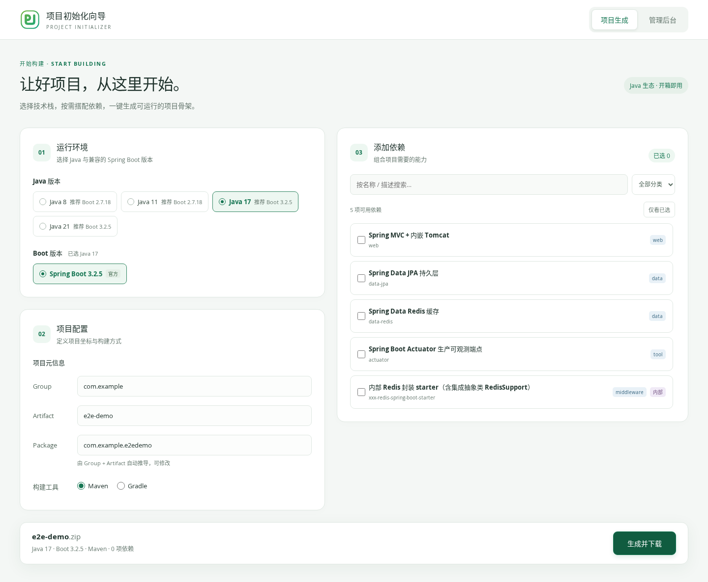
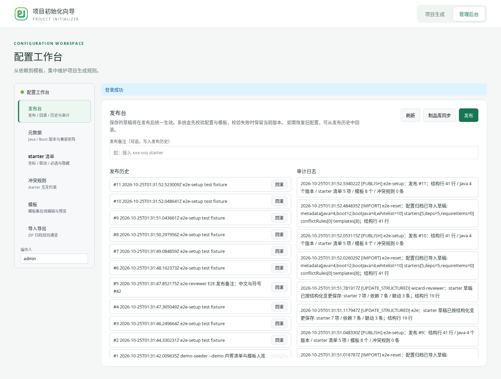
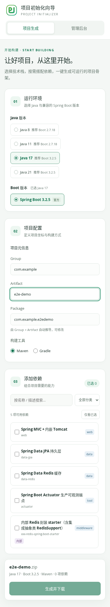

# 前端 UI 与易用性优化

基于 `fix/reliability-review` 分支的 `3a7d7b7` 实施。仅调整前端展示、交互及对应测试，不修改后端接口和配置契约。

## 主要变化

- 统一浅色绿色主题、居中内容区、字体层次、圆角、边框和按钮状态。
- 生成页拆为运行环境、项目配置、依赖选择三个分区，并展示下载文件名、版本、构建工具与依赖数量摘要。
- Java / Boot 版本使用可见选中状态和 `aria-pressed`。
- 依赖展示名称、标识和完整描述；省略与名称重复的描述；保留必选、依赖锁定、互斥和待选提示。
- 新增「仅看已选」筛选；取消最后一项时提示如何恢复列表；卸载组件时清除待执行搜索。
- 调整管理后台登录、分区导航和共用表单；登录支持原生 Enter 提交。
- 发布历史与审计日志独立滚动，并支持键盘聚焦，避免大量记录拉长工作台；回滚按钮不压缩换行。
- 窄屏下配置区单列排列，生成操作跟随内容，避免遮挡输入；后台宽表格在卡片内部滚动。
- 增加跳转主内容链接、搜索/分类的可访问名称、字段错误关联、键盘焦点和减少动态效果支持。

## 验证

| 检查 | 结果 |
| --- | --- |
| `npm test` | 313 / 313 通过 |
| `npm run typecheck` | 通过 |
| `npm run typecheck:e2e` | 通过 |
| `npm run build` | 通过 |
| Maven 后端打包（跳过后端测试） | 通过，用于启动隔离 E2E 服务 |
| `npm run test:e2e` | 28 / 28 通过，真实前端 + Spring Boot + 隔离 H2 |
| `git diff --check` | 通过 |

E2E 主视口为 1440×1000、1024×768；额外覆盖 768、390、320 像素宽度的生成页及后台全部六个分区，检查页面横向溢出。新增用例覆盖已选筛选、空态恢复、键盘切换与 Enter 登录。既有用例继续验证 Maven/Gradle ZIP 下载、发布与回滚相关保护、导入导出、包名竞态、依赖约束与模板编辑。

浏览器使用 Chromium 153。已人工查看生成页、管理页和手机页面截图。构建仍有既有的 API 客户端同时静态/动态导入提示，不影响构建结果。本轮未对生成项目执行依赖解析或运行验证，未运行后端单元测试。

## 页面截图

### 桌面生成页

### 管理工作台

### 手机生成页

